<div align="center">

**English** · [Русский](README.ru.md)

# 🪽 GitWings

**Animated SVG wings that describe a developer's skills.**

GitWings reads **all of a user's repositories** (languages, frameworks, commits, stars)<br/>
and grows a pair of wings you can pin to your GitHub profile page.<br/>
It can also draw wings for a **single repository**.

[](package.json)
[](tsconfig.json)
[](#-mcp-server-for-ai)
[](action.yml)
[](LICENSE)

</div>

<p align="center"></p>
<p align="center"></p>
<p align="center">
  
  
</p>

<details>
<summary><b>📑 Contents</b></summary>

- [Three ways to use it](#-three-ways-to-use-it)
- [Quick start](#-quick-start)
- [Profile: skills across all repositories](#-profile-skills-across-all-repositories)
- [Quirks: wings of your own](#-quirks-wings-of-your-own)
- [How data becomes wings](#-how-data-becomes-wings)
  - [Star tiers](#star-tiers)
  - [Traits](#traits)
  - [Icons and links](#icons-and-links)
- [CLI](#-cli)
- [MCP server (for AI)](#-mcp-server-for-ai)
- [Wings on your profile page](#-wings-on-your-profile-page)
- [FAQ](#-faq)
- [Development](#-development)
- [License](#-license)

</details>

## 🧭 Three ways to use it

| | Mode | What for |
|:-:|---|---|
| 💻 | **CLI** `gitwings` | by hand, locally |
| 🤖 | **MCP server** `gitwings-mcp` | for AI assistants: Claude Code, Claude Desktop, Cursor… |
| ⚙️ | **GitHub Action** | refreshes the wings on your profile every day |

## 🚀 Quick start

```bash
git clone https://github.com/Quaximur/GitWings && cd GitWings
npm install && npm run build
node dist/cli.js YOUR_LOGIN -o wings.svg
```

> [!TIP]
> Without a token the GitHub API allows 60 requests per hour. For profiles, set `GITHUB_TOKEN`: a classic token with no scopes or a fine-grained read-only token is enough.

## 👤 Profile: skills across all repositories

Pass a login and GitWings analyses every repository the user owns (forks and empty repositories are skipped):

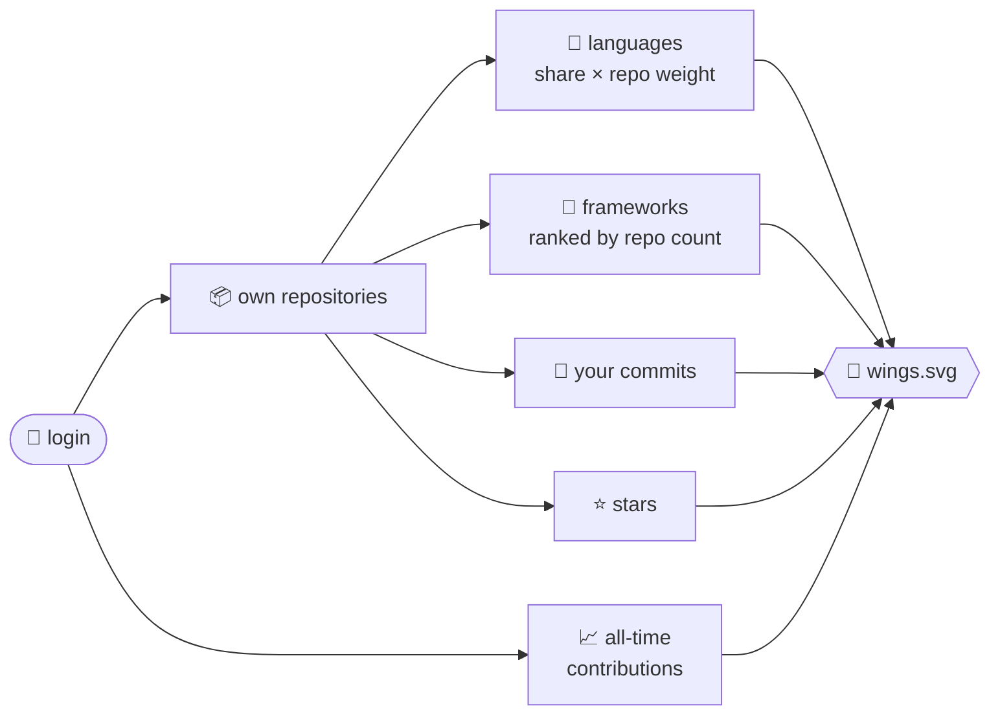

- **Languages are skills.** Each repository contributes *language share in the repo × repo weight*, where weight = `1 + log2(1 + your commits in the repo)`. What counts is how much *you* worked on it, not how big the code is, so one huge project full of vendored code can't drown out the rest.
- **Frameworks** are ranked by the number of repositories that use them. Badges show the most frequent ones and the tooltip says, for example, “React · 7 repos”.
- **Contributions** are all-time contributions, the same as the graph on your profile: the sum of `contributionCalendar` over every year in `contributionYears`. That includes commits to any repository, PRs, issues, reviews and private contributions if your profile shows them. Requires a token (GraphQL); without one, commits are used instead.
- **Commits** are your commits (author = you) across all analysed repositories. They set each repository's weight for languages.
- **Stars** are summed across your repositories.

| Flag | Effect |
|---|---|
| `--include-forks` | also analyse forks |
| `--include-private` | also analyse private repositories (needs that user's token with the `repo` scope) |
| `--max-repos N` | analyse at most `N` most recently pushed repositories |

> [!NOTE]
> With `--include-private` only aggregated languages and technologies reach the image. Repository names are never printed.

> [!IMPORTANT]
> Each repository costs about 3 API requests. Without a token only the 15 most recent repositories are analysed; with `GITHUB_TOKEN`, all of them.

## 🧬 Quirks: wings of your own

No two accounts grow the same wings. The login is hashed into a **genome**, a bit like a quirk in *My Hero Academia*: it is yours from birth, and your work only makes it stronger. The same login always gives the same wings, so they stay recognisable from day to day while the data makes them grow.

<p align="center">
  
  
  
</p>
<p align="center">
  
  
  
</p>
<p align="center"><sub>The same stats, six different names.</sub></p>

A wing is not picked from a list of types: it is assembled from independent genes, so they combine into tens of thousands of different pairs.

| Gene | Variants |
|---|---|
| **Primaries** (outer layer) | feathers · faceted crystal shards · a draconic membrane between finger bones, with claws · swaying spectral ribbons |
| **Coverts** (inner layers) | feathers · shards · scales · nothing (over a membrane or ribbons) |
| **Trail** | nothing · ghostly ribbons in a veil of light · long flame-shaped phoenix streamers |
| **Bone** (leading edge) | forged metal · spectral glow · metal with thorns |
| **Echo pairs** | 0, 1 or 2 smaller pairs behind the main one; three pairs make a seraph |
| **Feather style** | soft, plume, sickle or flame (blade and flowing come from the primary language) |
| **Markings** | peacock eyes, bands, speckles, a glowing veil or none |
| **Sigil** | the slowly turning arcane circle behind the wings: a star polygon, glyphs, ticks and a frame (rings, hexagon, triangle, square) |
| **Accent, motes, pose** | accent hue · fireflies, ash, sparks or star dust · how high the wings are raised and how far they sweep, the wingbeat tempo |

The genes also name the pair: *Iron Drake*, *Hollow Ophan*, *Lucent Phoenix of the Last Commit*. Want to see other wings? `--seed <any name>` grows the wings of that name from your data.

## 🎨 How data becomes wings

| Data | What changes |
|---|---|
| **Login** | the [quirk](#-quirks-wings-of-your-own): primaries, coverts, trail, bone, echo pairs, accent, sigil |
| **Contributions** (profile) / **commits** (repository) | number of feathers (7 → 19) and layers: primaries → secondaries (≥30) → coverts (≥300) → down scales (≥2000); for membranes and glass wings, the number of veins |
| **Stars** | wingspan, glow, sparkles and the [**tier**](#star-tiers) |
| **Languages** | feather colours: tip-to-body sectors by share of code, linguist colours; the “heart” in the centre is a donut chart of languages |
| **Primary language family** | feather shape: **blades** (Rust, C/C++, Go, Zig), **flowing** (Haskell, Elixir, Scala, F#…); otherwise the quirk picks soft, plume, sickle or flame feathers |
| **Frameworks and libraries** | visual [traits](#traits) |

### Star tiers

The tier sets the metal of the wing bone, the halo and the badge rims.

| Tier | Stars | Metal |
|---|--:|---|
| 🪶 **Fledgling** | < 10 |  slate |
| 🥉 **Rising** | 10+ |  bronze |
| 🥈 **Soaring** | 100+ |  silver |
| 🥇 **Celestial** | 1k+ |  gold, **halo appears** |
| 🔮 **Mythic** | 10k+ |  amethyst |
| 💠 **Seraphic** | 50k+ |  celestial cyan |

### Traits

| Trait | Stack | Effect |
|---|---|---|
| `aurora` | React, Vue, Angular, Svelte, Next, Tailwind, Blazor, RxJS/R3… | orbits of light with running sparks |
| `runes` | Express, Nest, Django, FastAPI, Spring, ASP.NET, gRPC, Axum… | glowing runes along the wing bone |
| `neural` | PyTorch, TensorFlow, Transformers, LangChain, Claude API, MCP… | a neural network woven into the feathers |
| `pixel` | Unity, Godot, Unreal, Bevy, Three.js, shaders… | twinkling pixels |
| `ember` | Rust, C, C++, Zig, Go | rising embers |
| `prism` | Flutter, React Native, Swift, Kotlin, MAUI | rainbow edge on the primaries |
| `hex` | Docker, Kubernetes, Terraform, GitHub Actions, Nix | hexagonal armour plates |
| `constellation` | pandas, NumPy, Spark, Jupyter, PostgreSQL… | a constellation behind the wings |
| `crystal` | Ethers, Hardhat, Solana, Solidity | floating crystals |

<details>
<summary><b>🔎 How frameworks are detected</b></summary>

<br/>

From manifests:

`package.json` · `*.csproj` · `Cargo.toml` · `go.mod` · `pyproject.toml` · `requirements.txt` · `Gemfile` · `composer.json` · `pubspec.yaml` · `pom.xml` · `build.gradle` · `mix.exs` · Unity `Packages/manifest.json`

And from marker files: `Dockerfile`, `project.godot`, `ProjectSettings/`, `*.tf` and others.

The registry lives in [src/tech.ts](src/tech.ts); adding a technology takes one line.

</details>

### Icons and links

The wings carry medallion badges with icons ([simple-icons](https://simpleicons.org), CC0): languages on the right wing, frameworks on the left. Every badge has a tooltip and a link to the technology's site, and the legend under the wings links out too.

> [!WARNING]
> GitHub renders README SVGs through ``, so links *inside* the picture aren't clickable there. They work when the SVG is opened directly (click the image). That's why `--snippet` also prints an HTML line with real links to each technology to put under the picture, and the workflow can [keep it in your README](#-wings-on-your-profile-page) up to date.

## 💻 CLI

```bash
# profile wings, light + dark variants
node dist/cli.js YOUR_LOGIN -o wings.svg --theme light --dark-output wings-dark.svg
```

```bash
# a single repository
node dist/cli.js facebook/react -o repo-wings.svg
```

```bash
# offline, from saved stats
node dist/cli.js --stats examples/tiny.json -o tiny.svg --background
```

<details>
<summary><b>⚙️ All flags</b></summary>

<br/>

| Flag | Description |
|---|---|
| `-o, --output <file>` | write the SVG here (default: stdout) |
| `--theme <t>` | `auto` \| `dark` \| `light` (default: `auto`) |
| `--dark-output <file>` | also write a dark-theme variant (use with `--theme light`) |
| `--background` | draw a card background |
| `--no-label` | wings only, no title, stats or legend |
| `--no-animate` | static SVG |
| `--no-credit` | no “grown with Quaximur/GitWings” link under the label |
| `--title <text>` | custom title |
| `--seed <name>` | grow the wings of another name (another quirk) from the same data |
| `--stats <file>` | render from a stats JSON instead of the API (offline) |
| `--json <file>` | also save the collected stats as JSON |
| `--snippet <url>` | print a README snippet that embeds the image from `<url>` |
| `--snippet-dark <url>` | dark variant URL for the snippet (`<picture>`, follows the GitHub theme) |
| `--readme <file>` | put the snippet between `<!-- gitwings:start -->` and `<!-- gitwings:end -->` in this file instead of printing it |
| `--include-forks` | also analyse forks |
| `--include-private` | also analyse private repositories |
| `--max-repos <n>` | analyse at most `n` most recently pushed repositories |
| `-q, --quiet` | no progress output |
| `-h, --help` | help |

</details>

## 🤖 MCP server (for AI)

<details open>
<summary><b>Claude Code</b></summary>

```bash
claude mcp add gitwings -e GITHUB_TOKEN=ghp_xxx -- node /path/to/GitWings/dist/mcp.js
```

</details>

<details>
<summary><b>Claude Desktop / Cursor</b></summary>

```json
{
  "mcpServers": {
    "gitwings": {
      "command": "node",
      "args": ["/path/to/GitWings/dist/mcp.js"],
      "env": { "GITHUB_TOKEN": "ghp_xxx" }
    }
  }
}
```

</details>

**Tools**

| Tool | Parameters | What it does |
|---|---|---|
| `generate_wings` | `target`, `include_forks?`, `include_private?`, `max_repos?`, `theme?`, `background?`, `label?`, `animate?`, `output_path?`, `image_url?` | a login gives skill wings across all repositories, `owner/repo` gives wings for one repository |
| `render_wings_from_stats` | `subject`, `stars`, `commits`, `languages`, `tech?`, … | no GitHub calls: for private projects, mock-ups and “what will my wings look like at 10k stars” |

> 💬 *“Generate wings for my profile and add them to my README.”*

## 🏠 Wings on your profile page

1. Create the repository `YOUR_LOGIN/YOUR_LOGIN`: GitHub shows its README on your profile page.
2. Copy [examples/profile-workflow.yml](examples/profile-workflow.yml) to `.github/workflows/wings.yml` and replace `YOUR_NAME/GitWings` with your fork of this repository.
3. Put two markers where the wings should go in your README:

```html
<!-- gitwings:start -->
<!-- gitwings:end -->
```

4. Run the workflow by hand: <kbd>Actions</kbd> → <kbd>Wings</kbd> → <kbd>Run workflow</kbd>. The SVGs land in the `output` branch, and the workflow fills the space between the markers with the picture plus a line of real, clickable links to your languages and frameworks. Every run rewrites that block, so the links always match the wings.

> [!TIP]
> Anything outside the markers is left alone. The picture is a `<picture>` that switches the variant by the GitHub theme, not the OS theme.
>
> Don't want the workflow committing to your README? Drop `readme:` and the commit step, and embed only the images:
>
> ```html
> <p align="center">
>   <picture>
>     <source media="(prefers-color-scheme: dark)" srcset="https://raw.githubusercontent.com/YOUR_LOGIN/YOUR_LOGIN/output/wings-dark.svg"/>
>     
>   </picture>
> </p>
> ```

> [!CAUTION]
> The built-in `github.token` sees only public repositories. To include private ones, create a token with the `repo` scope, store it in the `WINGS_TOKEN` secret and pass it in:
>
> ```yaml
> - uses: YOUR_NAME/GitWings@main
>   with:
>     token: ${{ secrets.WINGS_TOKEN }}
>     options: --include-private
> ```

<details>
<summary><b>📥 Action inputs</b></summary>

<br/>

| Input | Default | Description |
|---|---|---|
| `target` | `${{ github.repository_owner }}` | `owner/repo`, or a username for profile wings |
| `output` | `dist/wings.svg` | path of the light-theme SVG |
| `dark_output` | `dist/wings-dark.svg` | path of the dark-theme SVG (empty to skip) |
| `readme` | | README whose `<!-- gitwings:start -->` … `<!-- gitwings:end -->` block gets the wings and links (empty to skip) |
| `image_url` | `output` branch of the repository | public URL of the light SVG used in that block |
| `dark_image_url` | `output` branch of the repository | public URL of the dark SVG used in that block |
| `options` | | extra CLI flags, e.g. `--background --no-label` |
| `token` | `${{ github.token }}` | token for the GitHub API |

</details>

## ❓ FAQ

<details>
<summary><b>Why SVG and not shaders + GIF?</b></summary>

<br/>

A GIF is limited to 256 colours, so gradients and glow band badly. It also weighs 2–10 MB versus ~50 KB for the SVG, and rendering it would need a headless browser with WebGL in CI, which has no GPU. The SVG stays sharp on any screen and the viewer's browser plays the animation. For users with `prefers-reduced-motion` the animation is turned off.

</details>

<details>
<summary><b>Why does the label say “public repos” and “N+ technologies”?</b></summary>

<br/>

“public repos” means private repositories weren't analysed (see `--include-private`). The technology count has a `+` because only technologies from the [registry](src/tech.ts) are detected, so it's a lower bound.

</details>

<details>
<summary><b>Can I preview wings without touching GitHub?</b></summary>

<br/>

Yes: `--stats file.json` in the CLI or `render_wings_from_stats` in MCP. See [examples/tiny.json](examples/tiny.json) for the format.

</details>

## 🛠 Development

```bash
npm run build
```

Preview every example on dark and light backgrounds: [examples/gallery.html](examples/gallery.html).

```text
src/
├─ tech.ts     technology registry: dependencies → trait, icon, link; language colours
├─ github.ts   data collection: stars, commits, languages, file tree, manifest parsing
├─ genome.ts   login → quirk: wing genes, name, accent, sigil, markings, pose
├─ wings.ts    SVG renderer: wing assembly from genes, traits, badges, sigil, animations
├─ icons.ts    simple-icons icons
├─ cli.ts      CLI
└─ mcp.ts      MCP server
action.yml     composite GitHub Action
```

## 📄 License

[MIT](LICENSE) © Quaximur

<div align="center">
<sub>Made with 🪽 by <a href="https://github.com/Quaximur">Quaximur</a></sub>
</div>
