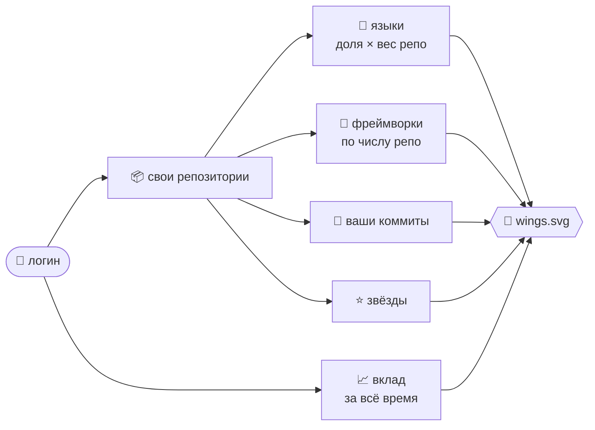

<div align="center">

[English](README.md) · **Русский**

# 🪽 GitWings

**Анимированные SVG-крылья, которые описывают навыки разработчика.**

GitWings анализирует **все репозитории пользователя** (языки, фреймворки, коммиты, звёзды)<br/>
и выращивает крылья, которые можно повесить на главную страницу GitHub-профиля.<br/>
Умеет рисовать крылья и для **одного репозитория**.

[](package.json)
[](tsconfig.json)
[](#-mcp-сервер-для-ai)
[](action.yml)
[](LICENSE)

</div>

<p align="center"></p>
<p align="center"></p>
<p align="center">
  
  
</p>

<details>
<summary><b>📑 Содержание</b></summary>

- [Три способа использования](#-три-способа-использования)
- [Быстрый старт](#-быстрый-старт)
- [Профиль: навыки по всем репозиториям](#-профиль-навыки-по-всем-репозиториям)
- [Причуды: у каждого свои крылья](#-причуды-у-каждого-свои-крылья)
- [Как данные превращаются в крылья](#-как-данные-превращаются-в-крылья)
  - [Тиры по звёздам](#тиры-по-звёздам)
  - [Черты](#черты)
  - [Иконки и ссылки](#иконки-и-ссылки)
- [CLI](#-cli)
- [MCP-сервер (для AI)](#-mcp-сервер-для-ai)
- [Крылья на главной странице профиля](#-крылья-на-главной-странице-профиля)
- [FAQ](#-faq)
- [Разработка](#-разработка)
- [Лицензия](#-лицензия)

</details>

## 🧭 Три способа использования

| | Режим | Для чего |
|:-:|---|---|
| 💻 | **CLI** `gitwings` | вручную, локально |
| 🤖 | **MCP-сервер** `gitwings-mcp` | для AI-ассистентов: Claude Code, Claude Desktop, Cursor… |
| ⚙️ | **GitHub Action** | ежедневное автообновление крыльев в профиле |

## 🚀 Быстрый старт

```bash
git clone https://github.com/Quaximur/GitWings && cd GitWings
npm install && npm run build
node dist/cli.js YOUR_LOGIN -o wings.svg
```

> [!TIP]
> Без токена GitHub API даёт 60 запросов в час. Для профилей лучше задать `GITHUB_TOKEN`: подойдёт classic-токен без прав или fine-grained с доступом read-only.

## 👤 Профиль: навыки по всем репозиториям

Если передать логин, анализируются все собственные репозитории пользователя (форки и пустые пропускаются):



- **Языки = навыки.** Каждый репозиторий даёт вклад *доля языка в репо × вес репо*, где вес = `1 + log2(1 + ваши коммиты в репо)`. Важен объём *вашей* работы, а не размер кода: один огромный проект с вендорным кодом не перекрывает остальные.
- **Фреймворки** ранжируются по числу репозиториев, где они используются. Эмблемы показывают самые частые, а подсказка сообщает, например, «React · 7 repos».
- **Вклад** — все контрибуции за всё время, как на графике в профиле: сумма `contributionCalendar` по всем годам из `contributionYears`. Туда входят коммиты в любых репозиториях, PR, issues, ревью и приватные контрибуции, если они показаны в профиле. Нужен токен (GraphQL); без него используются коммиты.
- **Коммиты** — ваши коммиты (author = вы) во всех проанализированных репозиториях. Они задают вес репозитория для языков.
- **Звёзды** суммируются по вашим репозиториям.

| Флаг | Эффект |
|---|---|
| `--include-forks` | анализировать и форки |
| `--include-private` | анализировать и приватные репозитории (нужен токен этого пользователя со scope `repo`) |
| `--max-repos N` | не больше `N` последних обновлённых репозиториев |

> [!NOTE]
> С `--include-private` на картинку попадают только агрегированные языки и технологии. Названия репозиториев не выводятся.

> [!IMPORTANT]
> На каждый репозиторий уходит ~3 запроса к API. Без токена анализируются только 15 последних репозиториев, с `GITHUB_TOKEN` — все.

## 🧬 Причуды: у каждого свои крылья

Двух одинаковых пар крыльев не бывает. Логин хешируется в **геном** — почти как причуда в *«Моей геройской академии»*: она даётся от рождения, а работа только делает её сильнее. Один и тот же логин всегда даёт одни и те же крылья, поэтому их узнаёшь изо дня в день, а данные заставляют их расти.

<p align="center">
  
  
  
</p>
<p align="center">
  
  
  
</p>
<p align="center"><sub>Одна и та же статистика, шесть разных имён.</sub></p>

Крыло не выбирается из списка типов: оно собирается из независимых генов, и вместе они дают десятки тысяч разных пар.

| Ген | Варианты |
|---|---|
| **Маховые** (внешний слой) | перья · гранёные кристаллы · драконья перепонка между пальцами-костями, с когтями · колышущиеся спектральные ленты |
| **Кроющие** (внутренние слои) | перья · кристаллы · чешуя · ничего (поверх перепонки или лент) |
| **Шлейф** | нет · призрачные ленты в вуали света · длинные огненные перья феникса |
| **Кость** (передний край) | кованый металл · спектральное свечение · металл с шипами |
| **Эхо-пары** | 0, 1 или 2 уменьшенные пары за основной; три пары — это серафим |
| **Стиль перьев** | мягкие, пышные, серповидные или огненные (клинки и струящиеся задаёт основной язык) |
| **Узор** | павлиньи глазки, полосы, крапинки, светящаяся вуаль или ничего |
| **Сигил** | медленно вращающийся магический круг за крыльями: звёздный многоугольник, глифы, насечки и рамка (кольца, шестиугольник, треугольник, квадрат) |
| **Акцент, частицы, поза** | акцентный оттенок · светлячки, пепел, искры или звёздная пыль · насколько подняты и раскинуты крылья, темп взмахов |

Гены же дают паре имя: *Iron Drake*, *Hollow Ophan*, *Lucent Phoenix of the Last Commit*. Хотите посмотреть на другие крылья? `--seed <любое имя>` вырастит крылья этого имени из ваших данных.

## 🎨 Как данные превращаются в крылья

| Данные | Что меняется |
|---|---|
| **Логин** | [причуда](#-причуды-у-каждого-свои-крылья): маховые, кроющие, шлейф, кость, эхо-пары, акцент, сигил |
| **Вклад** (профиль) / **коммиты** (репозиторий) | количество перьев (7 → 19) и слоёв: маховые → вторичные (≥30) → кроющие (≥300) → чешуя-пух (≥2000); у перепонок и стеклянных крыльев — число жилок |
| **Звёзды** | размах крыльев, свечение, искры и [**тир**](#тиры-по-звёздам) |
| **Языки** | цвета перьев: секторы от кончика к телу по доле кода, linguist-цвета; «сердце» в центре — кольцевая диаграмма языков |
| **Семейство основного языка** | форма перьев: **клинки** (Rust, C/C++, Go, Zig), **струящиеся** (Haskell, Elixir, Scala, F#…); иначе причуда выбирает мягкие, пышные, серповидные или огненные перья |
| **Фреймворки и библиотеки** | визуальные [черты](#черты) |

### Тиры по звёздам

Тир определяет металл кости крыла, гало и оправ эмблем.

| Тир | Звёзды | Металл |
|---|--:|---|
| 🪶 **Fledgling** | < 10 |  сталь |
| 🥉 **Rising** | 10+ |  бронза |
| 🥈 **Soaring** | 100+ |  серебро |
| 🥇 **Celestial** | 1k+ |  золото, **появляется гало** |
| 🔮 **Mythic** | 10k+ |  аметист |
| 💠 **Seraphic** | 50k+ |  небесная лазурь |

### Черты

| Черта | Стек | Эффект |
|---|---|---|
| `aurora` | React, Vue, Angular, Svelte, Next, Tailwind, Blazor, RxJS/R3… | орбиты света с бегущими огоньками |
| `runes` | Express, Nest, Django, FastAPI, Spring, ASP.NET, gRPC, Axum… | светящиеся руны вдоль кости крыла |
| `neural` | PyTorch, TensorFlow, Transformers, LangChain, Claude API, MCP… | нейросеть, вплетённая в перья |
| `pixel` | Unity, Godot, Unreal, Bevy, Three.js, шейдеры… | мерцающие пиксели |
| `ember` | Rust, C, C++, Zig, Go | поднимающиеся угли |
| `prism` | Flutter, React Native, Swift, Kotlin, MAUI | радужная кромка маховых перьев |
| `hex` | Docker, Kubernetes, Terraform, GitHub Actions, Nix | гексагональные пластины-доспех |
| `constellation` | pandas, NumPy, Spark, Jupyter, PostgreSQL… | созвездие за крыльями |
| `crystal` | Ethers, Hardhat, Solana, Solidity | парящие кристаллы |

<details>
<summary><b>🔎 Как определяются фреймворки</b></summary>

<br/>

По манифестам:

`package.json` · `*.csproj` · `Cargo.toml` · `go.mod` · `pyproject.toml` · `requirements.txt` · `Gemfile` · `composer.json` · `pubspec.yaml` · `pom.xml` · `build.gradle` · `mix.exs` · Unity `Packages/manifest.json`

И по маркерным файлам: `Dockerfile`, `project.godot`, `ProjectSettings/`, `*.tf` и другим.

Реестр находится в [src/tech.ts](src/tech.ts), новая технология добавляется одной строкой.

</details>

### Иконки и ссылки

На крыльях размещены эмблемы-медальоны с иконками ([simple-icons](https://simpleicons.org), CC0): на правом крыле — языки, на левом — фреймворки. У каждой эмблемы есть всплывающая подсказка и ссылка на сайт технологии; под крыльями — легенда, тоже со ссылками.

> [!WARNING]
> В README GitHub показывает SVG через ``, поэтому ссылки *внутри* картинки там не кликаются. Работают они, когда SVG открыт напрямую (по клику на картинку). Поэтому флаг `--snippet` дополнительно генерирует под картинкой HTML-строку с настоящими ссылками на каждую технологию, а workflow умеет [поддерживать её в README](#-крылья-на-главной-странице-профиля) в актуальном виде.

## 💻 CLI

```bash
# крылья профиля, светлый и тёмный варианты
node dist/cli.js YOUR_LOGIN -o wings.svg --theme light --dark-output wings-dark.svg
```

```bash
# один репозиторий
node dist/cli.js facebook/react -o repo-wings.svg
```

```bash
# офлайн, из сохранённой статистики
node dist/cli.js --stats examples/tiny.json -o tiny.svg --background
```

<details>
<summary><b>⚙️ Все флаги</b></summary>

<br/>

| Флаг | Описание |
|---|---|
| `-o, --output <file>` | куда записать SVG (по умолчанию stdout) |
| `--theme <t>` | `auto` \| `dark` \| `light` (по умолчанию `auto`) |
| `--dark-output <file>` | дополнительно записать тёмный вариант (вместе с `--theme light`) |
| `--background` | рисовать фон-карточку |
| `--no-label` | только крылья, без заголовка, статистики и легенды |
| `--no-animate` | статичный SVG |
| `--no-credit` | без ссылки «grown with Quaximur/GitWings» под подписью |
| `--title <text>` | свой заголовок |
| `--seed <name>` | вырастить из тех же данных крылья другого имени (другую причуду) |
| `--stats <file>` | рендер из JSON со статистикой вместо API (офлайн) |
| `--json <file>` | дополнительно сохранить собранную статистику в JSON |
| `--snippet <url>` | вывести сниппет для README с картинкой по `<url>` |
| `--snippet-dark <url>` | URL тёмного варианта для сниппета (`<picture>`, следует теме GitHub) |
| `--readme <file>` | вместо вывода вставить сниппет в этот файл между `<!-- gitwings:start -->` и `<!-- gitwings:end -->` |
| `--include-forks` | анализировать и форки |
| `--include-private` | анализировать и приватные репозитории |
| `--max-repos <n>` | не больше `n` последних обновлённых репозиториев |
| `-q, --quiet` | без вывода прогресса |
| `-h, --help` | справка |

</details>

## 🤖 MCP-сервер (для AI)

<details open>
<summary><b>Claude Code</b></summary>

```bash
claude mcp add gitwings -e GITHUB_TOKEN=ghp_xxx -- node /path/to/GitWings/dist/mcp.js
```

</details>

<details>
<summary><b>Claude Desktop / Cursor</b></summary>

```json
{
  "mcpServers": {
    "gitwings": {
      "command": "node",
      "args": ["/path/to/GitWings/dist/mcp.js"],
      "env": { "GITHUB_TOKEN": "ghp_xxx" }
    }
  }
}
```

</details>

**Инструменты**

| Инструмент | Параметры | Что делает |
|---|---|---|
| `generate_wings` | `target`, `include_forks?`, `include_private?`, `max_repos?`, `theme?`, `background?`, `label?`, `animate?`, `output_path?`, `image_url?` | логин даёт крылья навыков по всем репозиториям, `owner/repo` — по одному репозиторию |
| `render_wings_from_stats` | `subject`, `stars`, `commits`, `languages`, `tech?`, … | без обращения к GitHub: для приватных проектов, мокапов и прогноза «какими станут крылья при 10k звёзд» |

> 💬 *«Сгенерируй крылья для моего профиля и добавь их в README»*

## 🏠 Крылья на главной странице профиля

1. Создайте репозиторий `YOUR_LOGIN/YOUR_LOGIN`: его README GitHub показывает на странице профиля.
2. Скопируйте [examples/profile-workflow.yml](examples/profile-workflow.yml) в `.github/workflows/wings.yml` и замените `YOUR_NAME/GitWings` на свой форк этого репозитория.
3. Поставьте в README два маркера там, где должны быть крылья:

```html
<!-- gitwings:start -->
<!-- gitwings:end -->
```

4. Запустите workflow вручную: <kbd>Actions</kbd> → <kbd>Wings</kbd> → <kbd>Run workflow</kbd>. SVG появятся в ветке `output`, а место между маркерами workflow заполнит картинкой и строкой настоящих, кликабельных ссылок на ваши языки и фреймворки. Каждый запуск перезаписывает этот блок, так что ссылки всегда совпадают с крыльями.

> [!TIP]
> Всё, что вне маркеров, остаётся нетронутым. Картинка вставляется как `<picture>`, который переключает вариант по теме GitHub, а не по теме ОС.
>
> Не хотите, чтобы workflow коммитил в README? Уберите `readme:` и шаг с коммитом и вставьте только картинки:
>
> ```html
> <p align="center">
>   <picture>
>     <source media="(prefers-color-scheme: dark)" srcset="https://raw.githubusercontent.com/YOUR_LOGIN/YOUR_LOGIN/output/wings-dark.svg"/>
>     
>   </picture>
> </p>
> ```

> [!CAUTION]
> Встроенный `github.token` видит только публичные репозитории. Чтобы учесть приватные, создайте токен со scope `repo`, положите его в секрет `WINGS_TOKEN` и передайте:
>
> ```yaml
> - uses: YOUR_NAME/GitWings@main
>   with:
>     token: ${{ secrets.WINGS_TOKEN }}
>     options: --include-private
> ```

<details>
<summary><b>📥 Входные параметры Action</b></summary>

<br/>

| Параметр | По умолчанию | Описание |
|---|---|---|
| `target` | `${{ github.repository_owner }}` | `owner/repo` или логин для крыльев профиля |
| `output` | `dist/wings.svg` | путь к SVG светлой темы |
| `dark_output` | `dist/wings-dark.svg` | путь к SVG тёмной темы (пусто — не создавать) |
| `readme` | | README, в блок `<!-- gitwings:start -->` … `<!-- gitwings:end -->` которого вставляются крылья и ссылки (пусто — не трогать) |
| `image_url` | ветка `output` репозитория | публичный URL светлого SVG для этого блока |
| `dark_image_url` | ветка `output` репозитория | публичный URL тёмного SVG для этого блока |
| `options` | | дополнительные флаги CLI, например `--background --no-label` |
| `token` | `${{ github.token }}` | токен для GitHub API |

</details>

## ❓ FAQ

<details>
<summary><b>Почему SVG, а не шейдеры + GIF?</b></summary>

<br/>

GIF ограничен 256 цветами, поэтому градиенты и свечение в нём пойдут полосами. Весит он 2–10 МБ против ~50 КБ у SVG. Кроме того, для рендера нужен headless-браузер с WebGL в CI, где нет GPU. SVG чёткий на любом экране, а анимацию проигрывает браузер зрителя. Для пользователей с `prefers-reduced-motion` анимация отключается.

</details>

<details>
<summary><b>Почему в подписи «public repos» и «N+ technologies»?</b></summary>

<br/>

«public repos» значит, что приватные репозитории не анализировались (см. `--include-private`). У числа технологий стоит `+`, потому что определяются только технологии из [реестра](src/tech.ts), так что это нижняя оценка.

</details>

<details>
<summary><b>Можно посмотреть крылья, не обращаясь к GitHub?</b></summary>

<br/>

Да: `--stats file.json` в CLI или `render_wings_from_stats` в MCP. Формат — в [examples/tiny.json](examples/tiny.json).

</details>

## 🛠 Разработка

```bash
npm run build
```

Предпросмотр всех примеров на тёмном и светлом фоне: [examples/gallery.html](examples/gallery.html).

```text
src/
├─ tech.ts     реестр технологий: зависимости → черта, иконка, ссылка; цвета языков
├─ github.ts   сбор данных: звёзды, коммиты, языки, дерево файлов, парсинг манифестов
├─ genome.ts   логин → причуда: гены крыла, имя, акцент, сигил, узор, поза
├─ wings.ts    рендер SVG: сборка крыла из генов, черты, эмблемы, сигил, анимации
├─ icons.ts    иконки simple-icons
├─ cli.ts      CLI
└─ mcp.ts      MCP-сервер
action.yml     composite GitHub Action
```

## 📄 Лицензия

[MIT](LICENSE) © Quaximur

<div align="center">
<sub>Сделано с 🪽 — <a href="https://github.com/Quaximur">Quaximur</a></sub>
</div>
